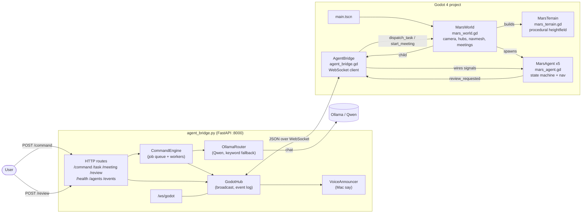
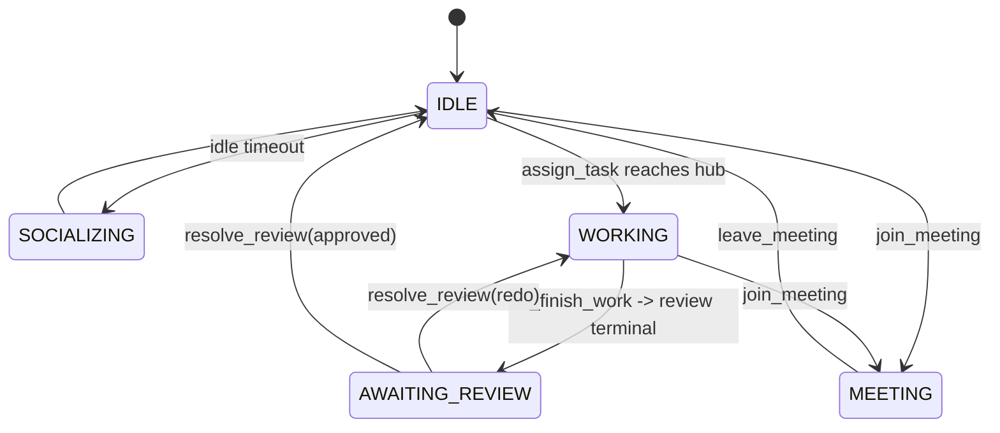

# Mars Sandbox — Code Graph

Generated by hand from the source (no `/graphify` tool was available). 14 tracked files, ~3.3k lines.

## Module graph

## State machine (`MarsAgent`)

## Review flow

1. `MarsAgent` finishes work, walks to the Review Terminal, emits `review_requested`.
2. `AgentBridge._on_agent_review_requested` sends a `review_request` over the WebSocket.
3. `GodotHub.handle_client_message` records it; `VoiceAnnouncer` speaks the prompt.
4. User calls `POST /review`; the hub broadcasts the decision; `AgentBridge` calls `MarsAgent.resolve_review`.

## Files and sizes

| File | Lines | Class | Role |
|---|---|---|---|
| `mars_world.gd` | 1092 | `MarsWorld` | Scene root: lighting, camera, hubs, navmesh, agents, meetings |
| `mars_agent.gd` | 870 | `MarsAgent` | Per-agent state machine, locomotion, needs, animation |
| `agent_bridge.py` | 735 | — | Backend: routing, WebSocket hub, voice, review gate |
| `mars_terrain.gd` | 357 | `MarsTerrain` | Dunes, crater rim, pads and roads |
| `agent_bridge.gd` | 255 | `AgentBridge` | Godot-side WebSocket client |
| `main.tscn` / `project.godot` | — | — | Minimal runnable project |

Dependencies: `agent_bridge.gd` preloads `mars_world.gd` and `mars_agent.gd`; `mars_world.gd` preloads `mars_agent.gd` and `mars_terrain.gd`. Python side needs `fastapi`, `uvicorn`, `httpx`, `pydantic`.
