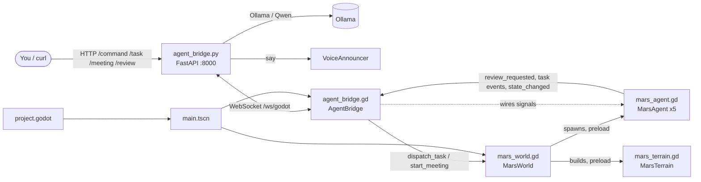
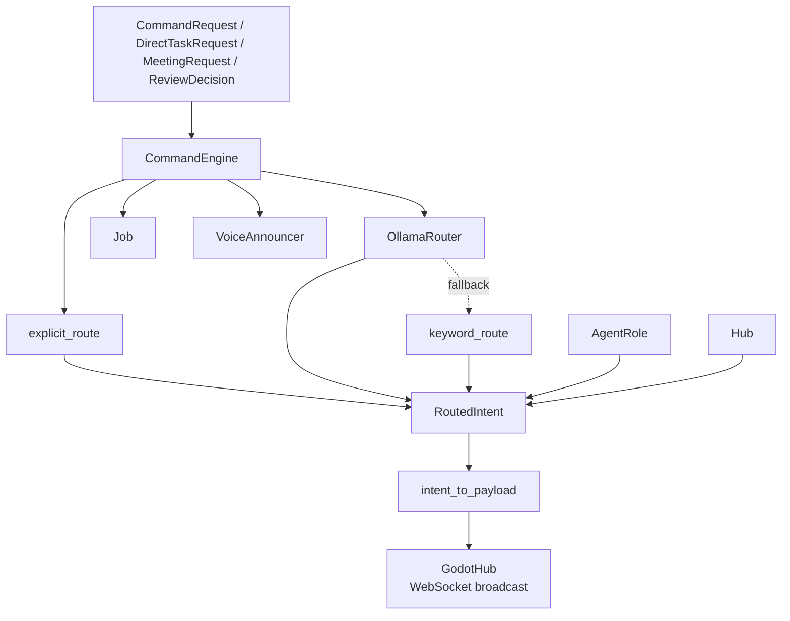
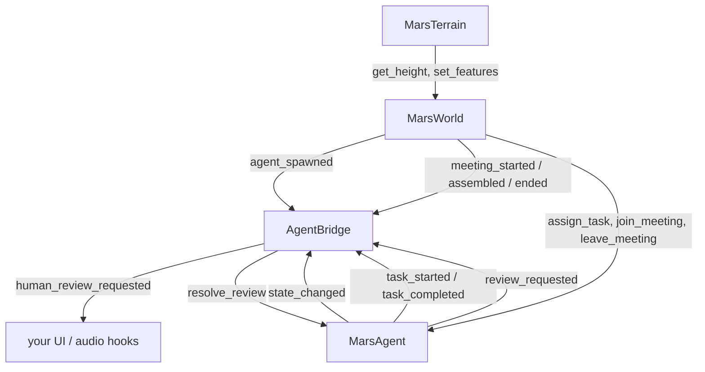
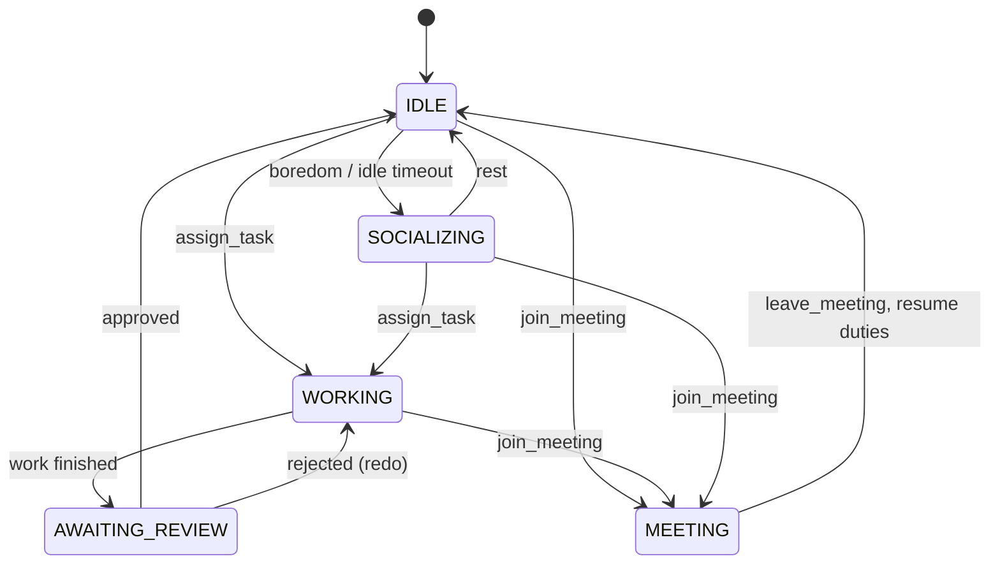

# Mars Sandbox: code graph

Hand-built from the source (not generated by graphify).

## Modules

## agent_bridge.py

## Godot class and signal flow

## Agent state machine (MarsAgent)

## Sizes

| File | Lines |
|---|---|
| mars_world.gd | 1092 |
| mars_agent.gd | 870 |
| agent_bridge.py | 735 |
| mars_terrain.gd | 357 |
| agent_bridge.gd | 255 |
